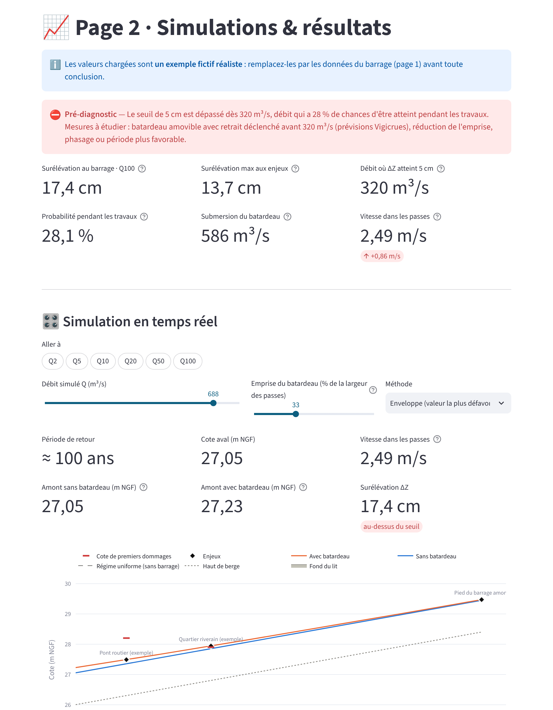
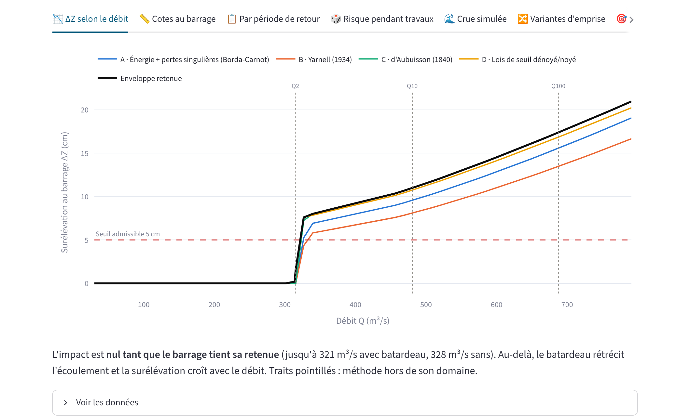

# BatCrue · impact hydraulique des batardeaux sur les crues

Outil d'étude de l'effet d'un **batardeau** sur les **niveaux de crue** au droit d'un barrage de
navigation, développé pour le cas des barrages de l'Oise (VNF) où le batardeau occupe environ un
tiers de la largeur d'écoulement pendant les travaux.

Il répond aux questions posées par le service police de l'eau : de combien la ligne d'eau monte-t-elle,
jusqu'où vers l'amont, à partir de quel débit le seuil admissible est-il dépassé, avec quelle
probabilité pendant la période d'installation, et à partir de quel débit le batardeau est-il submergé.



## Ce que fait l'outil

| Page | Contenu |
|---|---|
| **1 · Données & calculs** | Saisie du barrage (passes, seuils, retenue), du batardeau, de la rivière, de l'hydrologie et des critères ; schéma du barrage ; **note de calcul pas à pas** avec les formules et les valeurs |
| **2 · Simulations & résultats** | Pré-diagnostic, indicateurs clés, **simulation en temps réel** (curseurs débit et emprise), surélévation selon le débit, lignes d'eau, tableau par période de retour, risque pendant les travaux, crue simulée, variantes d'emprise, sensibilité et Monte-Carlo, vitesses/érosion/efforts, exports |
| **3 · Temps réel (Hub'Eau)** | Débit actuel d'une station officielle, niveau d'alerte du chantier, analyse des chroniques (loi de Gumbel, saisonnalité des crues) |
| **4 · Méthodologie** | Note méthodologique, autres méthodes et outils existants, démarche réglementaire |

**Physique utilisée** (usages français) : Manning-Strickler en lit composé, Bernoulli et pertes de
Borda-Carnot, hauteur critique de Bélanger, courbe de remous (pas standards, équation de Bresse),
formules de d'Aubuisson et de Yarnell, lois de seuil dénoyé/noyé, loi de Gumbel, risque poissonnien
pendant les travaux, Isbash, Laursen, règle de Lane. Détails : [note méthodologique](docs/NOTE_METHODOLOGIQUE.md).

## Installation et lancement

Prérequis : Python 3.10 ou plus récent.

```bash
pip install -r requirements.txt
streamlit run app.py
```

L'application s'ouvre dans le navigateur (http://localhost:8501). Sous Windows, un double-clic sur
`lancer_batcrue.bat` fait les deux étapes.

**Accès en ligne sans installation** : sur [Streamlit Community Cloud](https://share.streamlit.io),
se connecter avec GitHub, choisir ce dépôt, la branche et le fichier `app.py`. L'application est
alors accessible par un lien, depuis un ordinateur ou un téléphone.

## Version Excel

[`excel/BatCrue_etude_batardeau.xlsx`](excel/BatCrue_etude_batardeau.xlsx) reprend les calculs avec
de vraies formules (22 807), sans macro : on modifie les cellules jaunes de la feuille « Données »
et la feuille « Résultats » (synthèse et graphiques) se met à jour. Elle traite le cas courant de
passes de même cote de seuil.

```bash
python excel/generer_classeur.py            # régénère le classeur
python excel/verifier_classeur.py excel/BatCrue_etude_batardeau.xlsx   # double calcul Excel / Python
```

## Fiabilité

* **44 tests automatiques** sur des cas analytiques (`python -m pytest`).
* **Double calcul** : le classeur Excel recalculé par LibreOffice et le moteur Python donnent les
  mêmes résultats (**69 contrôles sur 69 conformes**, écarts inférieurs au millimètre), y compris
  après modification des données.
* Quatre méthodes indépendantes comparées ; l'enveloppe (valeur la plus défavorable) est retenue.



## Organisation du dépôt

```
app.py                  point d'entrée Streamlit
batcrue/                moteur de calcul (indépendant de l'interface)
  sections.py           géométrie, Manning-Strickler, hauteurs normale et critique
  ouvrage.py            méthodes A à D au droit du barrage
  remous.py             courbes de remous
  hydrologie.py         Gumbel, risque pendant les travaux, chroniques
  etude.py              orchestration, synthèse, sensibilité, Monte-Carlo
  erosion.py, efforts.py, hydrogramme.py, hubeau.py, rapport.py, exports.py
ui/                     pages et graphiques de l'application
excel/                  classeur Excel, générateur et vérification croisée
docs/                   note méthodologique, autres méthodes, réglementation, présentation
exemples/               jeu de données d'exemple (JSON) et rapport généré
tests/                  tests automatiques
```

Le moteur s'utilise aussi sans interface :

```python
from batcrue import EtudeBatardeau, defauts
etude = EtudeBatardeau(defauts())
s = etude.synthese()
print(round(s["dZ_barrage"] * 100, 1), "cm", "-", s["verdict"])
```

## Données d'exemple

Les valeurs chargées au démarrage décrivent un **barrage type fictif** inspiré de l'Oise moyenne
(trois passes de 20 m, batardeau sur la passe navigable, crue centennale d'environ 690 m³/s). Elles
servent à la démonstration et doivent être remplacées par les données du barrage étudié : la liste
des données à demander figure dans [Autres méthodes](docs/AUTRES_METHODES.md#4-données-à-rassembler-pour-passer-de-lexemple-au-cas-réel).

## Avertissement

BatCrue est un outil de **pré-diagnostic**. Ses résultats sont à valider par un ingénieur
hydraulicien et par le service police de l'eau ; pour le dossier réglementaire, il est conseillé
de les confirmer avec le modèle hydraulique de référence de la vallée
(voir [Autres méthodes](docs/AUTRES_METHODES.md)).
